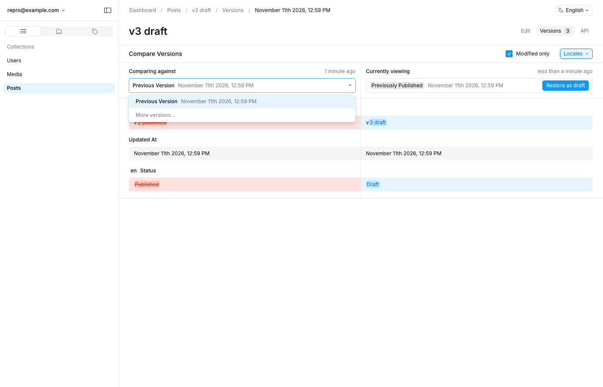
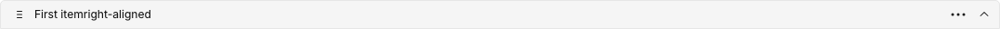

# Payload 4 beta reproductions

A blank `create-payload-app@4.0.0-beta.8` project (MongoDB) that reproduces four bugs with one `posts` collection. The reproduction code is in `src/collections/Posts.ts`, `src/components/ItemRowLabel.tsx` and `src/repro/`. `src/payload.config.ts` only adds the collection and a second locale.

## Setup

1. `cp .env.example .env`, then set `DATABASE_URL` to a MongoDB database and `PAYLOAD_SECRET` to any string.
2. `pnpm install`

## 1. Options added to the link's `linkType` field are rejected

`linkTypeContent` adds an `email` option to the `linkType` radio and one extra link field. `linkTypeOnlyContent` only adds the option.

```sh
pnpm exec tsc --noEmit
```

`src/repro/types.ts` fails twice with `Type '"email"' is not assignable to type '"custom" | "internal"'`, once per field.

```sh
pnpm payload createDocuments --slug posts --draft --documents @src/repro/email-link.json
pnpm payload createDocuments --slug posts --draft --documents @src/repro/custom-link.json
```

The first fails with `Invalid option: expected one of "custom"|"internal"`. The second, identical except for `"linkType": "custom"`, succeeds.

## 2. The upload node of an editor without upload collections has an optional `version`

`noUploadCollectionsContent` uses `UploadFeature({ disabledCollections: ['media'] })`. `pnpm exec tsc --noEmit` fails in `src/repro/types.ts`:

```
Type 'LexicalNodes_6CC01FE5' is not assignable to type 'SerializedLexicalNode'.
  Type '{ [k: string]: unknown; type: "upload"; version?: number | undefined; }' is not assignable to type 'SerializedLexicalNode'.
    Types of property 'version' are incompatible.
```

## 3. The version view labels the current draft and the published version "Previously Published"

`posts` has drafts and a localized `title`, so v4 stores `_status` per locale.

```sh
pnpm payload createDocuments --slug users --documents '[{"data":{"email":"dev@payloadcms.com","password":"test"}}]'
ID=$(pnpm -s payload createDocuments --slug posts --draft --locale en --documents '[{"data":{"title":"v1 draft","items":[{"label":"First item"}]}}]' --json | jq -r '.result.docs[0].id')
pnpm payload updateDocument --slug posts --id "$ID" --locale en --data '{"title":"v2 published","_status":"published"}'
pnpm payload updateDocument --slug posts --id "$ID" --locale en --draft --data '{"title":"v3 draft"}'
pnpm dev
```

Log in as `dev@payloadcms.com` / `test`, open the post in English, then Versions.

- "v3 draft" shows **Previously Published**. Expected: **Current draft**.
- "v2 published" shows **Previously Published**. Expected: **Currently Published**.
- "Comparing against" only offers "Previous Version". Expected: an entry for the currently published version.



## 4. A custom array `RowLabel` no longer spans the row header

`items` uses `src/components/ItemRowLabel.tsx`, a label with `width: 100%` and `justify-content: space-between`. Open the post from step 3: "First item" and "right-aligned" sit next to each other, because `.array-field__row-header` (126 px here) does not grow inside `.collapsible__header-wrap` (983 px).


